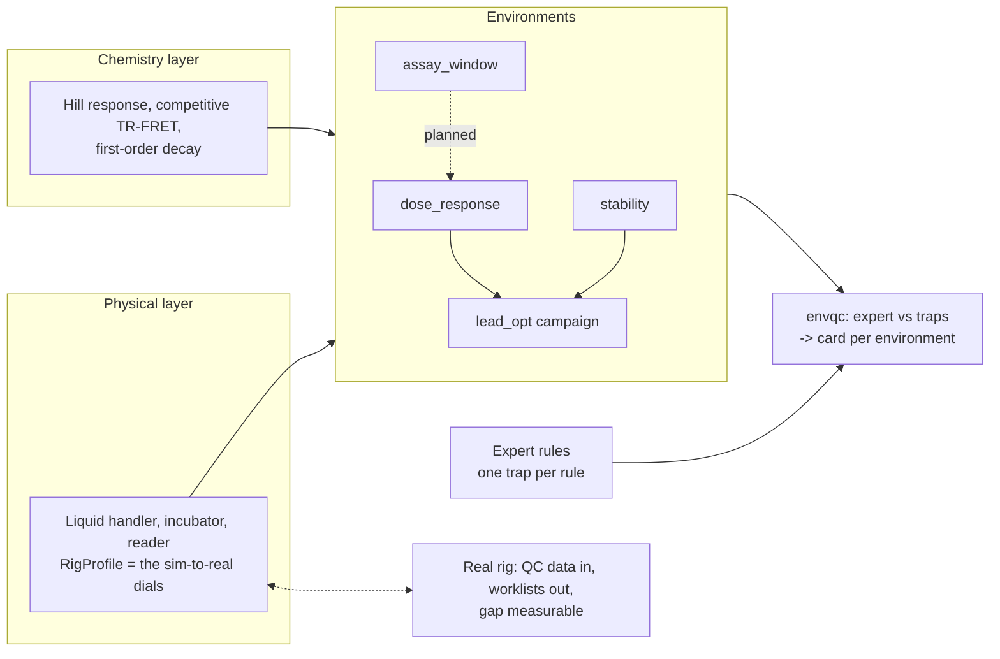

# drugdev-gym

RL environments for cell assays and drug development. Simulation first, and built so a real
liquid handler can calibrate it.

**Status: v0.1, simulation only.** Nothing here has touched hardware, cells, or compounds.
Every physical number is an assumed default ([docs/ASSUMPTIONS.md](docs/ASSUMPTIONS.md)).

**Where it is going: scale.** 1536-well plates and acoustic droplet dispensing, the format a
lab in the loop can run at scale. Acoustic transfer has no tips, so the mistakes that matter
change: DMSO backfill, the range a direct dilution can reach, source-plate handling, and
evaporation from a few microlitres. The environments below run on a 96-well, tip-based rig;
an acoustic 1536 environment is being built and will be admitted the same way as the others.

## The idea

The most valuable context in drug development is in bench scientists' heads: which mistakes
ruin a plate, and how you would know. The aim here is to capture that context in a form a
model can hill-climb on, and to prove the reward is true before scaling it.

1. **Environments.** Each environment is one stage of drug development (develop the assay,
   measure potency, measure stability) with a hidden truth and a reward scored against it.
   They share one interface, every task is generated from a seed instead of written by hand,
   and `lead_opt` reuses the potency and stability simulators inside one campaign.
2. **A physical layer under every environment.** The agent does not pick "a good protocol".
   It picks volumes, mix steps, tips, and layout, and those run on a simulated liquid
   handler with pipetting error, dead volume, carryover, evaporation, edge effects, and
   reader noise. Mixing, concentration range, ladder volume, the standard curve, the internal
   standard and the time points win or lose through that physics. Too few controls and a
   single replicate are caught by a QC-gate rule in the reward instead.
3. **Expert rules.** Each piece of bench knowledge is written down in plain words
   ([rules.toml](src/drugdevgym/rules.toml)) next to a trap: the expert protocol with that
   one rule broken.
4. **Environment QC before scale.** Each reward is validated like an assay: run the expert
   and every trap over the same seeds and measure whether the reward can tell them apart.
   Rules the reward cannot teach are reported as blind, not hidden.



## Environments

| environment | the agent decides | hidden truth | reward |
|---|---|---|---|
| `assay_window` | cell density and stimulation time, over up to 3 pilot plates | cell-line productivity, basal level, kinetics | Z' of a fresh validation plate, in analyte units |
| `dose_response` | serial dilution design: range, fold, points, transfer volume, mixing, tips, edges, lid, standards, controls | pEC50, Emax, Hill, stickiness of 4 compounds | pEC50 accuracy, halved if the declared plate fails Z' 0.5 |
| `stability` | time points, replicates, internal standard, mixing, lid, layout | half-lives of 3 compounds | log half-life accuracy, halved if time-zero CV fails |
| `lead_opt` | which analogs to make each round and how to test them, then one nominee | a 625-analog potency and stability landscape | true desirability of the nominee over the library best |
| `plate_review` | accept or repeat one finished dose-response plate, and the most likely cause | one planted execution fault, or none | 0.6 for the right verdict, 0.4 for the right cause |
| `timecourse_review` | the same call on one finished stability time course | one planted execution fault, or none | 0.6 for the right verdict, 0.4 for the right cause |
| `gi_fluid_stability` | which peptides go in gastric and intestinal fluid, time points, the quench per fluid, fresh or stored enzyme, the activity control, time zero, the internal standard | half-lives in each fluid, acid lability, the enzyme lot's activity | log half-life accuracy per peptide and fluid, halved if the run fails its QC |
| `gi_camp_potency` | forskolin level and cell number (titrated or from the handbook), IBMX, the agonist dilution, standards, how the curve top is fitted | agonist pEC50s at a Gi-coupled receptor, the cell line's forskolin potency and cAMP output | pEC50 accuracy, halved if a potency plate fails Z' 0.5 |
| `selectivity_panel` | which target each plate serves, single-point screen or full curve, the off-target dose range, controls and standards, and how each window is reported: a number or an honest lower bound | on-target and four off-target pEC50s for 4 compounds | accuracy of each selectivity window; a true bound at the labware limit is paid, a claim beyond what the data supports scores -0.5 |
| `cytotox_window` | the viability dose-response: dose range, exposure time, cells per well, DMSO matching, vehicle and full-kill controls, a cell-free interference control, layout; and how each CC50 is reported: a number or an honest lower bound | for 6 compounds: the CC50 after 72 h, fast or slow kinetics, a solubility limit, and for a few interference with the readout | CC50 accuracy; a true, tested bound is paid; a false alarm, a missed liability and a bound above what was tested lose credit; halved if a plate fails QC |

The last four were built by the environment factory (below), not by hand.

## Quick start

```bash
uv venv --python 3.12 .venv && uv pip install -e ".[dev]"
.venv/bin/drugdev-gym list
.venv/bin/drugdev-gym play dose_response --policy expert --seed 1
.venv/bin/drugdev-gym qc --seeds 200        # writes results/cards/*.md
.venv/bin/drugdev-gym learn                 # writes results/learning.md
.venv/bin/drugdev-gym knowledge             # writes results/knowledge.md
.venv/bin/drugdev-gym campaign              # writes results/campaign.md and campaign.json
.venv/bin/drugdev-gym baseline --model scripted:expert --tasks 5 --out /tmp/dry   # the model harness, dry run
.venv/bin/drugdev-gym cases --env plate_review --balanced --out cases.json   # blind cases for a human expert
.venv/bin/drugdev-gym score judgments.json --name NAME                       # score their calls against planted truth
.venv/bin/drugdev-gym rollouts --format sft --min-reward 0.6 --out data.jsonl # training data from the environments
.venv/bin/pytest -q
```

Driving an environment yourself (a script, a learner, or an LLM agent with one tool call):

```python
from drugdevgym import make

env = make("dose_response/randomized/7")       # environment / rig / seed
obs = env.reset()                              # obs["spec"] documents actions and reward
obs, reward, done, info = env.step({"type": "run_plate", "design": {
    "top_conc_nM": 30000, "dilution_factor": 4, "n_points": 10, "replicates": 1,
    "transfer_ul": 15, "mix": True, "new_tips": True, "avoid_edges": True, "lid": True,
    "standards": True, "controls_per_side": 6}})
# obs["wells"] is the raw plate: well, role, nominal concentration, ratio
obs, reward, done, info = env.step({"type": "report", "pEC50": {"cpd1": 7.2}})
# info["truth"] appears only now
```

Observations and actions are plain JSON. The hidden truth is never in an observation; a
test checks every reference policy's episodes for truth field names.

## Expert rules: what the rewards can teach

53 rules, 65 rule-trap pairs, 200 seeds each on the nominal rig
([results/knowledge.md](results/knowledge.md)). **52 of the 53 rules are drafts seeded from
general bench practice.** The expert has given one verdict so far, and it removed a rule:
three pairs are ruled moot and are left out of the counts. Of the 62 pairs that count:

- The reward teaches 30 outright (the expert wins on at least 90% of seeds).
- It teaches 27 only on average.
- It is blind to 5: choosing conditions by raw-ratio Z' in `assay_window`, skipping the
  standard curve or the internal standard upstream inside `lead_opt`, and both forskolin
  decisions in `gi_camp_potency` (saturating forskolin, and skipping the forskolin titration).

A cross-entropy learner given reward alone rediscovered 6 of the 7 checkable dose-response
rules in both of its runs. The one it missed, keeping off edge wells, is one the reward
teaches only on average. What the reward cannot see, the learner does not learn, so each
blind row is a to-do for the simulator or the reward.

A verdict works in both directions. An expert can add a rule, and an expert can rule one
moot (`status = "moot"`, or a `moot` list naming the traps): the row stays on its QC card as
a measurement and stops counting as something to teach.

To add knowledge: write the rule in `rules.toml`, add a trap that breaks only that rule, run
`drugdev-gym qc` and `drugdev-gym knowledge`. Tests refuse a trap no rule explains and a
dose-response trap that breaks more than its own rule.

## Expert judgment: the review environments

Rules capture what an expert would do. The review environments capture what an expert
would see. A run was executed from a fixed, sound protocol, possibly with one hidden
deviation: a step done wrong (an unmixed ladder, a starved ladder, a reused tip, an unmixed
spike, evaporation, under-filled wells) or a condition gone wrong (weak cells, an edge
effect, reader drift, an uneven internal standard). The reviewer gets the intended protocol,
the raw data and the known value of one reference compound, and makes one call: accept or
repeat, and why.

Truth is known by construction. Repeat is right when the standard analysis of that data
(spelled out in `spec()["label"]`) is off by more than the tolerance, loses a compound, or
the run fails its QC gate. A deviation that leaves every answer within tolerance should be
accepted. The cause is the deviation that was planted.

A scripted reviewer that applies plain QC rules ([judges.py](src/drugdevgym/judges.py)) is the
reference level. On 200 fresh seeds, nominal rig:

| environment | scripted QC rules | accept without looking | repeat without looking | verdict right | cause right |
|---|---|---|---|---|---|
| `plate_review` | 0.94 | 0.51 | 0.46 | 95.5% | 92.5% |
| `timecourse_review` | 0.88 | 0.52 | 0.36 | 85.0% | 93.0% |

Where the scripted rules lose is the call that takes judgment. In 73 of the 400 runs a
deviation was present but every answer stayed within tolerance; the rules got the verdict
right on 45 of them (14 of 18 plates, 31 of 55 time courses). They also mostly cannot see a
reused tip. Telling a deviation that matters from one that does not is what is left to teach.

The same cases can be given to a person. `drugdev-gym cases` exports them with no truth
inside (use `--truth` to freeze the answers in a separate file); the expert judges each one
blind and says why in their own words; `drugdev-gym score` scores those calls next to the
scripted rules. Their notes are the raw material for new rules, and any case they flag as
unrealistic is a simulator to-do. **No human reference has been recorded yet.**

Status: red-teamed once, with the findings fixed. The scripted reviewer's thresholds were set
on seeds 0 to 399 and are reported on seeds 10000 to 10199. The intended protocols are sound
on the nominal and randomized rigs only: on the harsh rig a large share of clean runs fail on
their own.

## Environment QC

200 seeds per policy, nominal rig, same hidden truth across policies.

| environment | expert mean reward | mistakes the reward sees (expert wins >= 90% of seeds) | sees only on average | blind to |
|---|---|---|---|---|
| `dose_response` | 0.68 | no mixing, raw ratio instead of the standard curve, narrow range, starved ladder, too few controls (by the QC gate) | reused tips (63.0%), edge wells (69.5%) | none |
| `stability` | 0.92 | no internal standard, no mixing after the spike, early-only time points, uncovered outer wells, single replicate (by the QC gate) | two time points, ignoring the limit of quantification, edge wells alone | none |
| `assay_window` | 0.60 | none | max cells, min cells, kit default, edge wells | choosing by raw-ratio Z' |
| `lead_opt` | 0.82 | one round only | no model, upstream no mixing, upstream two-point time course | upstream raw ratio, upstream no internal standard |
| `plate_review` | 0.94 (scripted QC rules, seeds 10000+) | none | never questioning the data, repeating everything | none |
| `timecourse_review` | 0.88 (scripted QC rules, seeds 10000+) | none | never questioning the data, repeating everything | none |
| `gi_fluid_stability` | 0.83 | stored enzyme (92.0%), no activity control, no internal standard, fitting against the clock while the enzyme weakens; acid quench in gastric fluid left warm overnight (two changes) | acid quench in gastric fluid, late first time point, no true time zero | none |
| `gi_camp_potency` | 0.63 | no forskolin, raw ratio instead of the cAMP standard curve, no mixing | no IBMX, free curve top, too many cells | saturating forskolin, skipping the forskolin titration |
| `cytotox_window` | 0.83 | unmatched DMSO and no full-kill control (both by the QC gate), doses above solubility counted as exposure, "clean" reported as an exact number | short exposure, edge wells, no interference control | none |
| `selectivity_panel` | 0.62 | off-targets dosed only over the on-target range, single-point screens, no controls, no standard curve on the off-target plates, on-target only, a window claimed past the tested range; a single-point hit reported as a curve (two changes) | raw ratio on every plate, "inactive" reported as an exact number | none |

Pairs the expert has ruled moot are left out of this table; they stay on the cards.

What that says, plainly:

- `stability` is the tightest environment. Only three comparisons anywhere clear the strict
  bar of Z' >= 0.5 between reward distributions: the starved ladder, the single replicate
  (gate-enforced), and the stability null. The paired win rate is the fairer reading and both
  are on every card.
- `assay_window` pays on average, not per episode: the expert passes its validation gate on
  99% of seeds against 60% for the kit default, but when the default happens to work it is
  cheaper, so the expert wins 67.5% of pairs.
- In `lead_opt`, one upstream mistake matters: a two-point stability time course loses 0.30
  reward on average, because it cannot tell fast compounds apart. Skipping the standard
  curve upstream does not hurt the nominee (the bias moves every analog the same way) and it
  is cheaper, so on randomized rigs the reward slightly prefers it. A nominee-only reward is a
  weak teacher of measurement quality; the single-assay environments are where that is taught.
- `gi_camp_potency` passes admission narrowly and does not yet teach the decision it is named
  for. The simulated Gi pathway removes the same fraction of the forskolin response at any
  forskolin level, so saturating forskolin costs nothing (the reward leans 0.003 toward it)
  and handbook conditions are nearly as good as a titration. Real cells do not behave that
  way; the missing term is listed in [docs/ASSUMPTIONS.md](docs/ASSUMPTIONS.md). Its expert
  scores 0.60 on randomized rigs (0.58 on fresh seeds).
- In `gi_fluid_stability` the stored-enzyme mistake is caught by the QC gate (the control
  substrate reads slow), not by a wrong half-life, and it sits near the 90% line: 85 to 92%
  depending on the block of seeds.
- `selectivity_panel` is the first environment where the answer can be a bound. Four of its
  visible rows are punished by a stated rule and not by simulated data: no controls, on-target
  only, a claim past the tested range, and off-targets dosed too low (a true bound earns
  credit only within 0.5 log units of the 100 uM limit). Only single-point screens and the
  missing standard curve lose through the data. Its plate budget never binds with four
  compounds, so the plan is forced and the judgment is in the dose range and the report.
- `cytotox_window` teaches its four visible rules by convention, not by simulated data. Skipping
  the DMSO match and leaving out the full-kill control fail the QC gate by rule; a dose above
  solubility and a "clean" number lose through the reporting rules. With the matched-vehicle
  rule switched off, skipping the DMSO match scores level with the expert or slightly ahead
  (the expert wins about 41% of seeds), because below 1% DMSO the mismatch costs almost
  nothing. The three mistakes that lose through the simulated data (short exposure, edge
  wells, no interference control) are only weak.
- The floor is low in three environments: a null policy that answers without running
  anything scores 0.06 to 0.21 in `dose_response`, `stability` and `lead_opt`. `assay_window`
  has no null; a fixed kit-default commit with no pilots scores 0.48 against 0.60.

Full cards: [results/cards](results/cards). The same run on randomized rigs is in the
`*_randomized.md` cards.

## Learning and transfer

A cross-entropy learner over the `dose_response` protocol choices, given reward only:

- Population mean reward climbs from 0.10 (random protocols) to 0.59 in 12 iterations.
- Its final designs score 0.72 and 0.75 on 100 unseen seeds, against 0.70 for the scripted
  expert. A few hundredths on 100 seeds: read it as matching the expert, not beating it.
- Both designs mix, use fresh tips, the standard curve, 8 controls a side, enough ladder
  volume and a wide range. Both use edge wells.
- Both chose 10-fold dilution steps, which no bench scientist would pick for curve
  definition. I have not pinned down why the simulator favours it, so treat it as a
  simulator artifact until shown otherwise.

Transfer, mean reward over 100 unseen seeds per rig (the harsh rig is never used in training):

| design | nominal rig | randomized rigs | harsh rig |
|---|---|---|---|
| learned on the nominal rig | 0.72 | 0.71 | 0.65 |
| learned on randomized rigs | 0.75 | 0.73 | 0.67 |
| scripted expert | 0.70 | 0.68 | 0.52 |

Both learned designs hold up better on the harsh rig than the scripted expert. Training on
randomized rigs came out slightly ahead of training on the nominal rig, but this is one
learner run per condition, so it is not evidence about domain randomization. This is
sim-to-sim transfer; no hardware is involved. Details: [results/learning.md](results/learning.md).

## Training data

An environment is only useful for post-training if it produces data cheaply.
`drugdev-gym rollouts` runs policies through the environments and writes JSON lines in two
shapes: whole episodes (every observation, action and reward, with the hidden truth in the
final record), or prompt and response pairs for supervised fine-tuning, filtered by reward,
each prompt carrying the episode so far and never the truth. 50 expert episodes in each of
the 10 environments take about 16 seconds on a laptop.

These rollouts come from scripted policies, so a model fine-tuned on them learns the
scripted expert and nothing more. They are a starting point and a source of labelled
negatives (each trap comes with its reward). Real post-training would let the model act in
the environment and learn from the reward itself; no model has done that here yet.

## Model baseline: what a model scores, and which mistakes it makes

`drugdev-gym baseline` runs a language model through the environments. Per environment it
reports the reward next to the scripted expert and the null policy on the same seeds, how
the episodes ended, the tokens used, and how often the model made each named mistake.
**No model has been run with it yet.**

```bash
.venv/bin/drugdev-gym baseline --model scripted:expert --tasks 5 --out /tmp/dry    # a dry run, no model
uv pip install -e ".[llm]"                                                          # the Anthropic SDK
.venv/bin/drugdev-gym baseline --model anthropic:claude-opus-5-5 --env dose_response --tasks 20 --attempts 2
```

- **The protocol is plain text.** The model is shown the task, the analysis tools and each
  observation, and ends every reply with one JSON object: an action, or a tool call. The
  hidden truth and the reward never go to it.
- **The tools are the analysis the scripted experts use** ([tools.py](src/drugdevgym/tools.py)),
  called by name on data the model has already been shown. Every choice of reading is a
  required argument with both options described the same way, so calling a tool does not
  make the choice.
- **Mistakes are read from what the model did.** Of the 62 rule-trap pairs, 44 are read from
  the design it ran (17 of them only as an exact match of the trap's own number or time
  points, which undercounts), 7 from the reading it chose in its last analysis call, and 11
  are not detected: reporting conventions, campaign strategy, judgment calls, 2 interactions
  counted on their single mistake, and 1 trap whose runs follow the data.
- **Checked with the scripted policies.** Every scripted policy scores exactly the same
  through the protocol as it does directly, in all 10 environments. Each of the 44 scripted
  traps is caught making its own mistake, and the expert is caught making none.
- **A real run spends money** and needs credentials the SDK can find. A refusal is recorded as
  a refusal and nothing is retried on another model, because a baseline measures one model.
  Baseline tasks use seeds from 300000 up.

## Sim to real: what exists and what does not

Built, and tested in simulation only:

- **Worklists out.** `sim2real.worklist_csv(env.step_log)` exports the fills, transfers,
  incubations and plate reads of an episode as a robot-neutral CSV, with each reagent named.
  LC-MS injections are not exported.
- **QC data in.** `RigProfile.from_qc(volumes, cv, bias)` fits the simulated pipetting error
  to a gravimetric or dye QC table.
- **A measurable gap.** `sim2real.fingerprint` summarises a control plate (CV, Z', window,
  edge ratio, row slope) and `sim2real.gap` reports where a real plate falls inside the
  distribution the simulator predicts. An uncovered statistic names the physics that is missing.

Not built: a compiler from worklists to a specific robot, and any run on hardware. The data
needed to close the gap, in order, is laid out in [docs/DATA.md](docs/DATA.md).

## Lab in the loop: what to measure first

A real lab cannot answer every training attempt, so its measurements have to be chosen.
`drugdev-gym campaign` sorts every rule-trap pair by the kind of choice the mistake changes,
because that decides what real data would price it
([results/campaign.md](results/campaign.md), [docs/LAB_LOOP.md](docs/LAB_LOOP.md)). Of the 62
pairs that count:

- 15 can be priced from complete raw records of correct runs: read the record the wrong way,
  or leave out the data the mistake leaves out. 6 hold on a plain record. 9 need the record
  to keep something specific, such as one well per time point.
- 14 are a point on a grid. 10 are a setting of the assay, which moves between days and cell
  batches, so the grid has to be repeated. 4 are a choice of concentrations: 2 are the top
  well of the expert's own ladder, and 2 need a second ladder until every well is dosed on
  its own.
- 14 change something physical on the rig: 10 handling and 4 position. Direct measurement
  comes first (a dye ladder, a sticky reference compound for tip reuse, plate weights,
  uniformity plates), paired runs second.
- 6 leave out run QC, and show their value only on a run that carries the fault the control
  exists for.
- 13 are not plate questions: reporting conventions, assay mistakes inside a campaign,
  campaign strategy, and judgment.

The kinds are drafts the expert has not read. An automated review, with one reviewer
prompted to read as a bench scientist, already moved 14 of the 62 pairs. The simulator checks
what each trap changes, by the 4 rules in [docs/LAB_LOOP.md](docs/LAB_LOOP.md). The plan will
not build while a trap has no kind or a stated kind fails that check, and a test fails while
any design field has none. Whether the named data would measure the cost on a bench is a
judgment the check cannot make. Nothing in the plan is measured.

## What review caught

The method is supposed to catch its author too. So far:

- The first `assay_window` scored raw-ratio Z', and its card showed a fixed kit default
  beating the expert. It now scores Z' in analyte units through the standard curve.
- An independent review then found that version paid a near-perfect window to a fully
  saturated assay, because off-curve wells all back-calculated to one clipped value.
  Controls off the top of the standard curve now fail.
- Several traps changed two things at once, so their cards measured the wrong mistake. They
  are split, and a test now enforces one broken rule per dose-response trap.
- A red team on the review environments found that one seed gave linked faults in both of
  them, so one could give the other away, and that three planted faults were really a
  mistake plus a worse rig. Faults are now drawn per environment and are one deviation each.
- **Still open:** the `dose_response` QC gate trusts the plate the agent declares. An agent
  can answer from a plate with no controls, run a cheap token plate with controls, and
  declare that one. This `gate_bypass` policy scores 0.66 against 0.68 for the expert and is
  kept on the card so it stays visible.

## Environment factory

New environments are built by agents and admitted by measurement, not by review of the code
alone. One agent builds an environment on its own branch from a one-page brief. A second
agent, told to break it, hunts for exploits, truth leaks, crashes and traps that are not
what they claim. A third fixes what was found. Then the gate is run on seeds nobody tuned on:

- the scripted expert scores at least 0.6 and a null policy at most 0.3;
- at least three single-mistake traps are visible or clean, and none is inverted;
- the whole suite passes and every existing card is unchanged, number for number.

| environment | status | why |
|---|---|---|
| `gi_fluid_stability` | admitted | expert 0.83 (0.80 on fresh seeds), four traps visible, none inverted |
| `gi_camp_potency` | admitted, narrowly | expert 0.63, exactly three traps visible, two blind |
| `antagonist_potency` | held on its branch, twice | reusing tips on the agonist ladder scores above the expert: its error cancels the tip-loss bias. A second pass added a reference antagonist of known potency and made it worse: correcting to the reference cancels the very analysis errors the rules are about, and a policy that skips the agonist curve then beats the expert on 82% of seeds. That commit is reverted on the branch |
| `selectivity_panel` | admitted on the second pass | expert 0.62 (0.64 on fresh seeds), six single mistakes visible, none inverted. The first review found four holes in the reward, the largest that a report with no supporting data scored the same as no report; all four are closed |
| `cytotox_window` | admitted on the third pass | expert 0.83 (0.82 on fresh seeds), four mistakes visible, none inverted. Two passes could not make the simulated data punish a skipped DMSO match, so it is now a QC convention: the vehicle wells must carry the top dose's DMSO. Without that rule the reward slightly prefers the mistake |

A failed gate is a result. Each held environment names the rule its reward cannot yet teach.

## Limits

- A policy that scores well here has learned this simulator. Transfer is unproven.
- The expert policies are scripted references, not upper bounds.
- Two cell assay formats (Gq-style and Gi cAMP, both competitive TR-FRET), two stability
  formats (plasma-style and gastric and intestinal fluid), one small additive SAR landscape.
  Selectivity is one panel of four compounds and toxicity is one general viability assay. No
  PK, organ-level safety or solubility assay yet.
- The shared liquid handler loses a little compound to every tip, fresh or not. Three
  factory builds traced a bias of 0.04 to 0.08 log units in scripted potencies to it, and in
  two unmerged environments it offsets a real mistake. Whether the size is right is a
  question for instrument QC data.
- Rewards use a 0.5 log tolerance (0.3 for time-course review) chosen by hand, not from real assay
  reproducibility. Review labels are a hard cut at that tolerance, so some sit close to it.
- Edge wells barely matter in the one-hour assays as simulated; that is a gap in the
  simulator, not a finding about edge wells.
- The package is open, so anyone holding a task id can recompute its hidden truth, and a
  search over candidate seeds recovers it from a single observation, at about a millisecond
  a seed in `dose_response`. Private seeds from a wide range are not enough: a held-out evaluation needs a
  private salt held by whoever serves the tasks, and a blind human study needs opaque case
  ids or answers frozen at export.
- The half-life analysis drops points below the limit of quantification one injection at a
  time, which reads slightly long when a time point straddles the limit.

## Roadmap

- Scale: the acoustic 1536 environment, then the other formats rebuilt on that rig.
- Expert review of the 52 draft rules, and new rules in the expert's own words.
- A human expert reference for the review environments.
- More environments: PK, solubility, hit triage, and antagonist potency, held on its branch (above).
  Each must ship with its card.
- A PyLabRobot compiler for the worklists.
- Level 1 and 2 data from [docs/DATA.md](docs/DATA.md): instrument QC, then reference-compound replays,
  in the order of [docs/LAB_LOOP.md](docs/LAB_LOOP.md).
- A schema and a validator for a returned run record.
- A private salt for served tasks, and a manifest of seed ranges, versions and reward ranges.
- Run the model baseline on 2 or 3 current models (the harness is built, no model has been
  run): the reward per environment and how often a model makes each named mistake. This
  comes before any lab run: a mistake no model makes is not worth a plate.
- Replicate the learner over seeds before saying anything about domain randomization.
- Close the `gate_bypass` exploit.
- Close the loop on the environment factory: let agents propose the environments and traps
  too, with the same admission gate.
