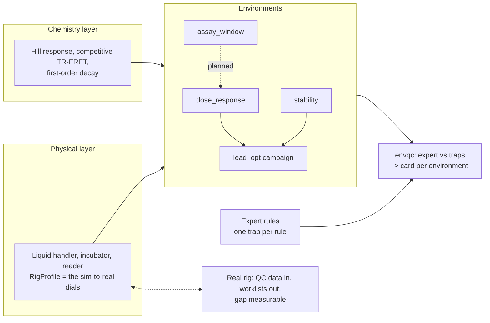

# drugdev-gym

RL environments for cell assays and drug development. Simulation first, and built so a real
liquid handler can calibrate it.

**Status: v0.1, simulation only.** Nothing here has touched hardware, cells, or compounds.
Every physical number is an assumed default ([docs/ASSUMPTIONS.md](docs/ASSUMPTIONS.md)).

## The idea

The most valuable context in drug development is in bench scientists' heads: which mistakes
ruin a plate, and how you would know. The aim here is to capture that context in a form a
model can hill-climb on, and to prove the reward is true before scaling it.

1. **Environments.** Each environment is one stage of drug development (develop the assay,
   measure potency, measure stability) with a hidden truth and a reward scored against it.
   They share one interface, every task is generated from a seed instead of written by hand,
   and `lead_opt` reuses the potency and stability simulators inside one campaign.
2. **A physical layer under every environment.** The agent does not pick "a good protocol".
   It picks volumes, mix steps, tips, lids, and layout, and those run on a simulated liquid
   handler with pipetting error, dead volume, carryover, evaporation, edge effects, and
   reader noise. Mixing, concentration range, ladder volume, the standard curve, the internal
   standard and the time points win or lose through that physics. Too few controls and a
   single replicate are caught by a QC-gate rule in the reward instead.
3. **Expert rules.** Each piece of bench knowledge is written down in plain words
   ([rules.toml](src/drugdevgym/rules.toml)) next to a trap: the expert protocol with that
   one rule broken.
4. **Environment QC before scale.** Each reward is validated like an assay: run the expert
   and every trap over the same seeds and measure whether the reward can tell them apart.
   Rules the reward cannot teach are reported as blind, not hidden.



## Environments

| environment | the agent decides | hidden truth | reward |
|---|---|---|---|
| `assay_window` | cell density and stimulation time, over up to 3 pilot plates | cell-line productivity, basal level, kinetics | Z' of a fresh validation plate, in analyte units |
| `dose_response` | serial dilution design: range, fold, points, transfer volume, mixing, tips, edges, lid, standards, controls | pEC50, Emax, Hill, stickiness of 4 compounds | pEC50 accuracy, halved if the declared plate fails Z' 0.5 |
| `stability` | time points, replicates, internal standard, mixing, lid, layout | half-lives of 3 compounds | log half-life accuracy, halved if time-zero CV fails |
| `lead_opt` | which analogs to make each round and how to test them, then one nominee | a 625-analog potency and stability landscape | true desirability of the nominee over the library best |

## Quick start

```bash
uv venv --python 3.12 .venv && uv pip install -e ".[dev]"
.venv/bin/drugdev-gym list
.venv/bin/drugdev-gym play dose_response --policy expert --seed 1
.venv/bin/drugdev-gym qc --seeds 200        # writes results/cards/*.md
.venv/bin/drugdev-gym learn                 # writes results/learning.md
.venv/bin/drugdev-gym knowledge             # writes results/knowledge.md
.venv/bin/pytest -q
```

Driving an environment yourself (a script, a learner, or an LLM agent with one tool call):

```python
from drugdevgym import make

env = make("dose_response/randomized/7")       # environment / rig / seed
obs = env.reset()                              # obs["spec"] documents actions and reward
obs, reward, done, info = env.step({"type": "run_plate", "design": {
    "top_conc_nM": 30000, "dilution_factor": 4, "n_points": 10, "replicates": 1,
    "transfer_ul": 15, "mix": True, "new_tips": True, "avoid_edges": True, "lid": True,
    "standards": True, "controls_per_side": 6}})
# obs["wells"] is the raw plate: well, role, nominal concentration, ratio
obs, reward, done, info = env.step({"type": "report", "pEC50": {"cpd1": 7.2}})
# info["truth"] appears only now
```

Observations and actions are plain JSON. The hidden truth is never in an observation; a
test checks every reference policy's episodes for truth field names.

## Expert rules: what the rewards can teach

20 rules, 29 rule-trap pairs, 200 seeds each on the nominal rig
([results/knowledge.md](results/knowledge.md)). **All 20 rules are drafts seeded from general
bench practice. None has been reviewed by an expert yet.**

- The reward teaches 11 pairs outright (the expert wins on at least 90% of seeds).
- It teaches 13 only on average.
- It is blind to 5: no lid in `dose_response` and `assay_window`, choosing conditions by
  raw-ratio Z' in `assay_window`, and, inside `lead_opt`, skipping the standard curve or the
  internal standard upstream.

A cross-entropy learner given reward alone rediscovered 6 of the 8 checkable dose-response
rules in both of its runs. The two it missed, keeping off edge wells and lidding the plate,
are the two the reward is weak or blind on. What the reward cannot see, the learner does
not learn, so each blind row is a to-do for the simulator or the reward.

To add knowledge: write the rule in `rules.toml`, add a trap that breaks only that rule, run
`drugdev-gym qc` and `drugdev-gym knowledge`. Tests refuse a trap no rule explains and a
dose-response trap that breaks more than its own rule.

## Environment QC

200 seeds per policy, nominal rig, same hidden truth across policies.

| environment | expert mean reward | mistakes the reward sees (expert wins >= 90% of seeds) | sees only on average | blind to |
|---|---|---|---|---|
| `dose_response` | 0.68 | no mixing, raw ratio instead of the standard curve, narrow range, starved ladder, too few controls (by the QC gate) | reused tips (63.0%), edge wells (69.5%) | no lid |
| `stability` | 0.92 | no internal standard, no mixing after the spike, early-only time points, no lid on edge wells, single replicate (by the QC gate) | two time points, ignoring the limit of quantification, edge wells alone, no lid alone | none |
| `assay_window` | 0.60 | none | max cells, min cells, kit default, edge wells | no lid, choosing by raw-ratio Z' |
| `lead_opt` | 0.82 | one round only | no model, upstream no mixing, upstream two-point time course | upstream raw ratio, upstream no internal standard |

What that says, plainly:

- `stability` is the tightest environment. Only three comparisons anywhere clear the strict
  bar of Z' >= 0.5 between reward distributions: the starved ladder, the single replicate
  (gate-enforced), and the stability null. The paired win rate is the fairer reading and both
  are on every card.
- In `stability`, edge wells alone and no lid alone cost about 0.01 each; together they cost
  0.19. The mistake is the combination.
- `assay_window` pays on average, not per episode: the expert passes its validation gate on
  99% of seeds against 60% for the kit default, but when the default happens to work it is
  cheaper, so the expert wins 67.5% of pairs.
- In `lead_opt`, one upstream mistake matters: a two-point stability time course loses 0.30
  reward on average, because it cannot tell fast compounds apart. Skipping the standard
  curve upstream does not hurt the nominee (the bias moves every analog the same way) and it
  is cheaper, so on randomized rigs the reward slightly prefers it. A nominee-only reward is a
  weak teacher of measurement quality; the single-assay environments are where that is taught.
- The floor is low in three environments: a null policy that answers without running
  anything scores 0.06 to 0.21 in `dose_response`, `stability` and `lead_opt`. `assay_window`
  has no null; a fixed kit-default commit with no pilots scores 0.48 against 0.60.

Full cards: [results/cards](results/cards). The same run on randomized rigs is in the
`*_randomized.md` cards.

## Learning and transfer

A cross-entropy learner over the `dose_response` protocol choices, given reward only:

- Population mean reward climbs from 0.10 (random protocols) to 0.59 in 12 iterations.
- Its final designs score 0.72 and 0.75 on 100 unseen seeds, against 0.70 for the scripted
  expert. A few hundredths on 100 seeds: read it as matching the expert, not beating it.
- Both designs mix, use fresh tips, the standard curve, 8 controls a side, enough ladder
  volume and a wide range. Both dropped the lid and use edge wells.
- Both chose 10-fold dilution steps, which no bench scientist would pick for curve
  definition. I have not pinned down why the simulator favours it, so treat it as a
  simulator artifact until shown otherwise.

Transfer, mean reward over 100 unseen seeds per rig (the harsh rig is never used in training):

| design | nominal rig | randomized rigs | harsh rig |
|---|---|---|---|
| learned on the nominal rig | 0.72 | 0.71 | 0.65 |
| learned on randomized rigs | 0.75 | 0.73 | 0.67 |
| scripted expert | 0.70 | 0.68 | 0.52 |

Both learned designs hold up better on the harsh rig than the scripted expert. Training on
randomized rigs came out slightly ahead of training on the nominal rig, but this is one
learner run per condition, so it is not evidence about domain randomization. This is
sim-to-sim transfer; no hardware is involved. Details: [results/learning.md](results/learning.md).

## Sim to real: what exists and what does not

Built, and tested in simulation only:

- **Worklists out.** `sim2real.worklist_csv(env.step_log)` exports the fills, transfers,
  incubations and plate reads of an episode as a robot-neutral CSV, with each reagent named.
  LC-MS injections are not exported.
- **QC data in.** `RigProfile.from_qc(volumes, cv, bias)` fits the simulated pipetting error
  to a gravimetric or dye QC table.
- **A measurable gap.** `sim2real.fingerprint` summarises a control plate (CV, Z', window,
  edge ratio, row slope) and `sim2real.gap` reports where a real plate falls inside the
  distribution the simulator predicts. An uncovered statistic names the physics that is missing.

Not built: a compiler from worklists to a specific robot, and any run on hardware. The data
needed to close the gap, in order, is laid out in [docs/DATA.md](docs/DATA.md).

## What review caught

The method is supposed to catch its author too. So far:

- The first `assay_window` scored raw-ratio Z', and its card showed a fixed kit default
  beating the expert. It now scores Z' in analyte units through the standard curve.
- An independent review then found that version paid a near-perfect window to a fully
  saturated assay, because off-curve wells all back-calculated to one clipped value.
  Controls off the top of the standard curve now fail.
- Several traps changed two things at once, so their cards measured the wrong mistake. They
  are split, and a test now enforces one broken rule per dose-response trap.
- **Still open:** the `dose_response` QC gate trusts the plate the agent declares. An agent
  can answer from a plate with no controls, run a cheap token plate with controls, and
  declare that one. This `gate_bypass` policy scores 0.66 against 0.68 for the expert and is
  kept on the card so it stays visible.

## Limits

- A policy that scores well here has learned this simulator. Transfer is unproven.
- The expert policies are scripted references, not upper bounds.
- One assay format (Gq-style, competitive TR-FRET), one stability format, one small additive
  SAR landscape. No PK, selectivity, solubility, or toxicity yet.
- Rewards use a 0.5 log tolerance chosen by hand, not from real assay reproducibility.
- Lids and edge wells barely matter in the one-hour assays as simulated; that is a gap in
  the simulator, not a finding about lids.

## Roadmap

- Expert review of the 20 draft rules, and new rules in the expert's own words.
- More environments: PK, selectivity panel, solubility, hit triage. Each must ship with its card.
- A PyLabRobot compiler for the worklists.
- Level 1 and 2 data from [docs/DATA.md](docs/DATA.md): instrument QC, then reference-compound replays.
- An LLM-agent harness over `env.spec()`, and a pass-rate profile of current models per
  environment (difficulty calibration). No model has been run on these environments yet.
- Replicate the learner over seeds before saying anything about domain randomization.
- Close the `gate_bypass` exploit.
- A self-improving loop: agents propose new environments and new traps, and a proposal is
  admitted only if its envqc card passes.
