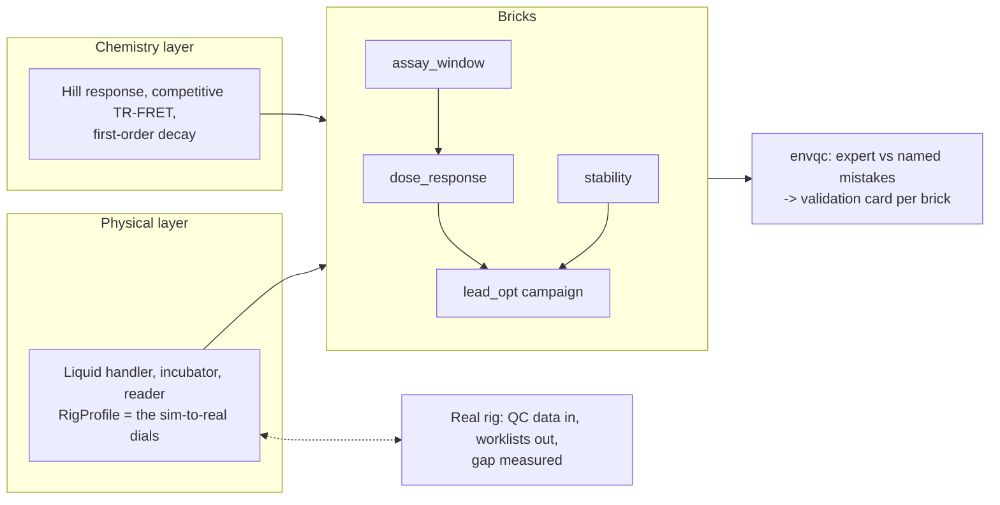

# rx-bricks

Snap-together RL environments for cell assays and drug development. Simulation first, and
built so a real liquid handler can calibrate it.

**Status: v0.1, simulation only.** Nothing here has touched hardware, cells, or compounds.
Every physical number is an assumed default ([docs/ASSUMPTIONS.md](docs/ASSUMPTIONS.md)).

## The idea

Scaling RL environments for drug discovery is easy if you do not care whether the reward is
true. This repo cares, in three ways:

1. **Bricks.** Each brick is one stage of drug development (develop the assay, measure
   potency, measure stability) with a hidden truth and a reward scored against it. Bricks
   share one interface, so they snap into longer campaigns, and every task is generated from
   a seed instead of written by hand.
2. **A physical layer under every brick.** The agent does not pick "a good protocol". It
   picks volumes, mix steps, tips, lids, and layout, and those run on a simulated liquid
   handler with pipetting error, dead volume, carryover, evaporation, edge effects, and
   reader noise. Good bench practice wins because of the physics, not because a rubric says so.
3. **Environment QC before scale.** Each reward is validated like an assay: run an expert
   policy and a set of named bench mistakes over the same seeds and measure whether the
   reward can tell them apart. Mistakes the reward cannot see are reported as blind.



## Bricks

| brick | the agent decides | hidden truth | reward |
|---|---|---|---|
| `assay_window` | cell density and stimulation time, over up to 3 pilot plates | cell-line productivity, basal level, kinetics | Z' of a fresh validation plate, in analyte units |
| `dose_response` | serial dilution design: range, fold, points, transfer volume, mixing, tips, edges, lid, standards, controls | pEC50, Emax, Hill, stickiness of 4 compounds | pEC50 accuracy, halved if the plate fails Z' 0.5 |
| `stability` | time points, replicates, internal standard, mixing, lid, layout | half-lives of 3 compounds | log half-life accuracy, halved if time-zero CV fails |
| `lead_opt` | which analogs to make each round and how to test them, then one nominee | a 625-analog potency and stability landscape | true desirability of the nominee over the library best |

`lead_opt` is the first composite: it runs the `dose_response` and `stability` physics
inside a design-make-test-analyze loop, so a sloppy protocol upstream costs reward downstream.

## Quick start

```bash
uv venv --python 3.12 .venv && uv pip install -e ".[dev]"
.venv/bin/rxbricks list
.venv/bin/rxbricks play dose_response --policy expert --seed 1
.venv/bin/rxbricks qc --seeds 200        # writes results/cards/*.md
.venv/bin/rxbricks learn                 # writes results/learning.md
.venv/bin/pytest -q
```

Driving a brick yourself (a script, a learner, or an LLM agent with one tool call):

```python
from rxbricks import make

env = make("dose_response/randomized/7")       # brick / rig / seed
obs = env.reset()                              # obs["spec"] documents actions and reward
obs, reward, done, info = env.step({"type": "run_plate", "design": {
    "top_conc_nM": 30000, "dilution_factor": 4, "n_points": 10, "replicates": 1,
    "transfer_ul": 15, "mix": True, "new_tips": True, "avoid_edges": True, "lid": True,
    "standards": True, "controls_per_side": 6}})
# obs["wells"] is the raw plate: well, role, nominal concentration, ratio
obs, reward, done, info = env.step({"type": "report", "pEC50": {"cpd1": 7.2}})
# info["truth"] appears only now
```

Observations and actions are plain JSON. The hidden truth is never in an observation; a
test enforces that.

## Environment QC

200 seeds per policy, nominal rig, same hidden truth across policies. A trap is the expert
protocol with one named mistake.

| brick | expert mean reward | mistakes the reward sees (expert wins >= 90% of seeds) | sees only on average | blind to |
|---|---|---|---|---|
| `dose_response` | 0.68 | no mixing, raw ratio instead of the standard curve, narrow range, starved ladder, too few controls | open edge wells | reused tips (borderline: 63% of pairs here, 60% on randomized rigs) |
| `stability` | 0.92 | no internal standard, no mixing after the spike, open edge wells, early-only time points, single replicate | two time points, ignoring the limit of quantification | none |
| `assay_window` | 0.60 | none | max cells, min cells, kit default, open edge wells | optimising raw-ratio Z' |
| `lead_opt` | 0.82 | one round only, no testing | sloppy measurement, no model | none |

What that says, plainly:

- `stability` is the tightest brick. The others carry seed-to-seed spread, so only two
  comparisons anywhere (both in `stability`) clear the strict bar of Z' >= 0.5 between reward
  distributions. The paired win rate is the fairer reading and both are on every card.
- `assay_window` pays on average, not per episode: the expert passes its validation gate on
  99% of seeds against 61% for the kit default, but when the default happens to work it is
  cheaper, so the expert wins only 67% of pairs.
- In `lead_opt`, sloppy measurement loses 0.27 reward on average but wins 43% of pairs. A
  systematic measurement bias moves every analog the same way and keeps the ranking, so a
  nominee-only reward is a weak teacher of measurement quality. That is the case for scoring
  each brick on its own as well as the campaign.
- The floor is low: a null policy that answers without running anything scores 0.06 to 0.22.

Full cards: [results/cards](results/cards). The same run on randomized rigs is in the
`*_randomized.md` cards.

## Learning and transfer

A cross-entropy learner over the `dose_response` protocol choices, given reward only:

- Population mean reward climbs from 0.12 (random protocols) to 0.59 in 12 iterations.
- Its final design scores 0.72 on 100 unseen seeds, against 0.70 for the scripted expert.
- It found mixing, fresh tips, the standard curve, controls, and enough ladder volume by itself.
- It also chose 10-fold dilution steps. Fewer transfers before the EC50 means less sticky
  compound lost to tips. That is a property of this simulator's adsorption model: a good
  example of why a simulated win needs a real check before anyone believes it.

Transfer, mean reward over 100 unseen seeds per rig (the harsh rig is never used in training):

| design | nominal rig | randomized rigs | harsh rig |
|---|---|---|---|
| learned on the nominal rig | 0.72 | 0.71 | 0.65 |
| learned on randomized rigs | 0.71 | 0.67 | 0.53 |
| scripted expert | 0.70 | 0.68 | 0.53 |

I expected training on randomized rigs to give the more robust design. In this run it did
not: the nominal-trained design held up better on the harsh rig. The two designs differ in
edge use and in controls (8 a side against 4), and this is one learner seed per condition,
so it is not evidence either way about domain randomization. Replicating over learner seeds
is on the roadmap. Details: [results/learning.md](results/learning.md).

## Sim to real: what exists and what does not

Built, and tested in simulation only:

- **Worklists out.** `sim2real.worklist_csv(env.last_log)` exports every fill, transfer,
  incubation, and read the agent's protocol expanded to, as a robot-neutral CSV.
- **QC data in.** `RigProfile.from_qc(volumes, cv, bias)` fits the simulated pipetting error
  to a gravimetric or dye QC table.
- **A measurable gap.** `sim2real.fingerprint` summarises a control plate (CV, Z', window,
  edge ratio, row slope) and `sim2real.gap` reports where a real plate falls inside the
  distribution the simulator predicts. An uncovered statistic names the physics that is missing.

Not built: a compiler from worklists to a specific robot, and any run on hardware. The data
needed to close the gap, cheapest first, is laid out in [docs/DATA.md](docs/DATA.md).

## What the QC caught in my own first draft

The first `assay_window` brick scored raw-ratio Z'. Its card showed a fixed kit-default
condition beating the expert who ran pilots: the reward could not see assay development at
all. Cause: a competitive immunoassay keeps a decent raw-ratio Z' even when it is saturated.
The brick now scores Z' in analyte units through the standard curve, the reader has an
additive noise floor, and cell lines vary more. That is the method working as intended, on
its author.

## Limits

- A policy that scores well here has learned this simulator. Transfer is unproven.
- The expert policies are scripted references, not upper bounds.
- One assay format (Gq-style, competitive TR-FRET), one stability format, one small additive
  SAR landscape. No PK, selectivity, solubility, or toxicity yet.
- Rewards use a 0.5 log tolerance chosen by hand, not from real assay reproducibility.

## Roadmap

- More bricks: PK, selectivity panel, solubility, hit triage. Each must ship with its card.
- A PyLabRobot compiler for the worklists.
- Level 1 and 2 data from [docs/DATA.md](docs/DATA.md): instrument QC, then reference-compound replays.
- An LLM-agent harness over `env.spec()`, and a pass-rate profile of current models per brick
  (difficulty calibration). No model has been run on these bricks yet.
- Replicate the learner over seeds before saying anything about domain randomization.
- A self-improving loop: agents propose new bricks and new traps, and a proposal is admitted
  only if its envqc card passes. Growth of the environment library gated by QC.
